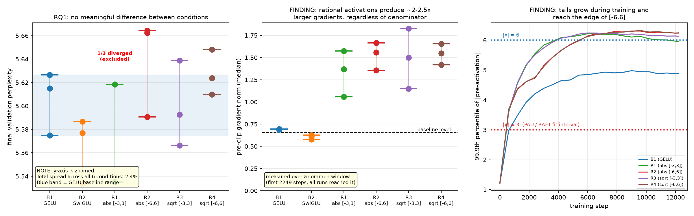

# 学習可能有理活性化関数の decoder-only Transformer における追試（詳細版）

> 3分で全体像を知りたい場合は [README.md](../README.md) を参照。
> 以下は実験設定・機構分析・自己訂正の記録を含む完全版。

学習可能な有理活性化関数（Padé Activation Unit, PAU）を decoder-only の自己回帰言語モデルに適用し、
先行研究の結果が再現するかを検証した。あわせて、先行研究がいずれも無検証で継承している
分母設計 `Q(x) = 1 + |A(x)|` の妥当性を数値解析の観点から検討した。

**結論を先に書く: 先行研究の主要な結果は再現しなかった。分母設計に関する仮説も支持されなかった。**
それでも得られた知見は §2 に記す。

---

## 1. 何を検証しようとしたか

### 位置づけ: 新規手法の提案ではなく、追試（replication study）

本テーマには直接の先行研究が存在する。

| 文献 | 内容 | 検証対象 |
|---|---|---|
| Molina et al., ICLR 2020 | safe PAU を提案。`F(x) = P(x)/(1+\|A(x)\|)`、次数 [5,4] | CNN 画像分類 |
| **RAFT** (Fang et al., EACL 2023) | safe PAU を **encoder-only Transformer (BERT系)** に適用しスクラッチ事前学習。GELU ベースラインを上回ると報告（val PPL 5.00 vs 5.18） | encoder-only 言語モデル (MLM) |
| **KAT** (Yang & Wang) | safe PAU を KAN の基底として ViT に適用 | Vision Transformer |
| Boullé et al. | 低次数有理活性化。**PAU の絶対値による非平滑性を批判** | PDE 求解、GAN |

**RAFT が encoder-only で既に肯定的な結果を報告している。**
したがって本研究は「Transformer 言語モデルへの初適用」ではない。
未検証なのは以下であり、ここを検証対象とした。

- **RQ1（主軸）**: RAFT の結果は **decoder-only の自己回帰言語モデル**でも再現するか
- **RQ3**: 学習中に `A(x)` の符号変化（＝分母の微分不連続点）は発生するか
- **RQ4**: 平滑な分母 `1+√(ε+A²)` は PAU 型より学習を安定させるか
- **RQ5**: pre-activation は近似区間 [-3,3] に収まるか

### 実験設定

decoder-only Transformer をスクラッチ学習。**6条件 × 3 seed = 18本**（GPU 実行 約14.6時間、RTX 3060）。

| 項目 | 設定 |
|---|---|
| モデル | 6層 / d_model 384 / 6ヘッド / block 256、**13,870,848 パラメータ** |
| データ | TinyStories、自前学習の BPE（vocab 8192）、**1条件あたり 100M トークン** |
| 比較条件 | B1: GELU / B2: SwiGLU / R1〜R4: 有理活性化（分母 × 近似区間 の 2×2） |
| 学習率 | `lr_θ = 1e-3`（線形減衰）、`lr_RAF = 7.14e-3`（定数）— **RAFT と同じ比 7.14・同じスケジュール形** |

**パラメータ数は全条件で一致させた**（B1/B2 は 13,870,848 で完全一致、有理条件は +60 = 全体の 0.0004%）。
SwiGLU はゲート行列が1枚多いため `d_ff` を 1536→1024 に調整している。



---

## 2. 何が分かったか

### 2.1 有理活性化は、分母設計によらず、ベースラインの約2〜2.5倍の勾配ノルムを生む

クリップ前の勾配ノルムの中央値（全条件が到達している先頭2249ステップの共通窓で測定）:

| B1 (GELU) | B2 (SwiGLU) | R1 (abs [-3,3]) | R2 (abs [-6,6]) | R3 (sqrt [-3,3]) | R4 (sqrt [-6,6]) |
|---|---|---|---|---|---|
| 0.689 | 0.610 | **1.369** | **1.559** | **1.500** | **1.549** |

**4つの有理条件すべてがベースラインの約2〜2.5倍**であり、この差は分母設計（`abs` / `sqrt`）にも
近似区間（[-3,3] / [-6,6]）にも依存しない。有理活性化という構造そのものに由来する。

先行研究（RAFT / KAT）はいずれも勾配ノルムの水準を報告していない。
KAT は limitations で「`a_m` と `b_n` の高階勾配が入力のべき乗に依存するため不安定になりうる」と
指摘しているが、実測値は示していない。**本研究はその指摘に対する定量的な実測を与える。**

実務的な含意: 有理活性化を使う場合、勾配クリッピングや学習率の設定を
GELU 基準のまま流用すると、実効的な更新量が変わってしまう。

### 2.2 pre-activation の裾は学習中に育ち、[-6,6] の境界まで達する

PAU も RAFT も GELU を **[-3,3]** で近似して初期化している。この区間設定の妥当性を実測した。

seed0、全層の最大値と 99.9%点:

| step | B1 max\|x\| | B1 q99.9 | R1 max\|x\| | R1 q99.9 | R2 max\|x\| | R2 q99.9 |
|---|---|---|---|---|---|---|
| 0 | 2.22 | 1.22 | 2.22 | 1.22 | 2.23 | 1.22 |
| 600 | 7.76 | 2.97 | 7.58 | 3.59 | 7.54 | 3.66 |
| 6600 | 12.24 | 4.89 | 13.34 | 6.22 | 13.87 | 6.22 |
| 12199 | 14.26 | 4.89 | 14.42 | **5.95** | 15.80 | **6.24** |

- **学習開始時点では `max|x| = 2.22` で [-3,3] に完全に収まっている**
- **step 600 で既に `max|x| ≈ 7.6` と [-6,6] を超える**
- 最終的に `max|x| ≈ 14〜16`、**99.9%点も 6.0〜6.24 と [-6,6] の境界に達する**

この挙動は実験前に予測されていた（「学習初期は LayerNorm 直後でほぼ正規分布、
重い裾は学習の過程で後から育つ」）。**予測が実測で裏付けられた。**

また、13.8M パラメータ・TinyStories という小規模設定でも裾は育った。
「小規模モデルでは outlier features が発生しないかもしれない」という事前に想定したリスクは現実化しなかった。

**有理条件（R1/R2）の方が GELU より裾が重い**（q99.9 が 5.95〜6.24 vs 4.89）。
活性化関数と重みの相互作用と考えられるが、機構は特定できていない。

### 2.3 RAFT と同一設定を忠実に再現した上で、decoder-only では発散が観測された

条件 R1 は RAFT の設定を忠実に再現したものである。

- 分母: safe PAU `1 + |A(x)|`（実装が Molina 版と一致することを RAFT の依存パッケージのソースで確認）
- 次数: [5,4]
- 近似区間: GELU を **[-3,3]** でフィット
- 学習率: 有理係数と本体で分離し、**RAFT と同じ比 7.14・同じスケジュール形**（θ は線形減衰、RAF は定数、warmup 1%）

この設定で、**3 seed 中 1 つ（seed=2）が step 2249 で発散した。**

発散はクリップ前の勾配ノルムが **1ステップで 3.2 → 45.4 に急騰**して起きた
（直前100ステップの中央値 2.21 の約20倍）。損失自体は 2.15〜2.35 で安定しており、
**loss を見ているだけでは予兆が読めない。**
事前に「クリップ前の勾配ノルム」を診断量に指定していなければ検出できなかった。

**注意して読むべき点**: これは 3 seed 中 1 件の観測である。
「decoder-only では RAFT の設定が必ず発散する」ことを示すものではないし、
統計的に有意な主張もできない。**「同一設定を忠実に再現した上で、発散する場合があった」という事実の報告に留める。**

---

## 3. 何が支持されなかったか

### 3.1 RQ1（主軸）: RAFT の「有理活性化 > GELU」は再現しなかった

最終 validation perplexity のレンジ（3 seed、発散した run は除外）:

| 条件 | val_ppl レンジ | 完走 |
|---|---|---|
| B1 (GELU) | [5.5749, 5.6266] | 3/3 |
| B2 (SwiGLU) | [5.5341, 5.5866] | 3/3 |
| R1 (abs [-3,3]) | [5.5349, 5.6184] | **2/3** |
| R2 (abs [-6,6]) | [5.5905, 5.6645] | 3/3 |
| R3 (sqrt [-3,3]) | [5.5662, 5.6389] | 3/3 |
| R4 (sqrt [-6,6]) | [5.6097, 5.6483] | 3/3 |

**全6条件の広がりは合計で 2.36% しかない。**

判定基準（事前に固定: seed 3本のレンジが重ならないこと）を全15ペアに適用した結果、
「差がある」と判定されたのは **B2 vs R2**（隙間 0.069%）と **B2 vs R4**（隙間 0.414%）の2件のみ。
**いずれも SwiGLU が有理活性化より良い方向**であり、効果量も極小である。

**B1（GELU）はどの条件とも差がない。**

→ **RAFT が encoder-only (MLM) で報告した「有理活性化は GELU を上回る」という結果は、
decoder-only の自己回帰言語モデル・この規模では再現しなかった。**

再現しなかった理由の候補（いずれも本研究では切り分けていない）:
学習目的の違い（MLM vs 自己回帰）、モデル規模（110M vs 13.8M）、
データ規模（12.1B vs 100M トークン）、データの性質（Wikipedia vs TinyStories）。

### 3.2 RQ4: 平滑分母による安定性の改善は支持されなかった

`1+√(ε+A²)` は `1+|A|` と実効次数も裾の挙動も一致し、**違いが平滑性だけ**になるよう設計した
統制比較である（Phase 0 で設計）。

| 指標 | R1 (abs [-3,3]) | R3 (sqrt [-3,3]) | R2 (abs [-6,6]) | R4 (sqrt [-6,6]) |
|---|---|---|---|---|
| 発散 | 1/3 | 0/3 | 0/3 | 0/3 |
| 損失スパイク（3 seed 合計） | 1 | 0 | 1 | 1 |
| 勾配ノルム中央値（共通窓） | **1.369** | 1.500 | 1.559 | 1.549 |
| val_ppl レンジ | [5.535, 5.618] | [5.566, 5.639] | [5.591, 5.665] | [5.610, 5.648] |

- 発散は R1 のみ1件。方向としては平滑分母に有利だが、**1/3 vs 0/3 は seed 3本では偶然と区別できない**
- **勾配ノルムはむしろ R1（PAU型）が4条件中で最も低く、仮説と逆方向**
- perplexity に差はない

→ **「平滑分母が学習を安定させる」という仮説は、この実験では支持されない。**

Boullé et al. による「PAU は非平滑」という批判に対しては、後述の Phase 0 の結果と合わせて
「**近似区間の内側では絶対値は恒等的に不活性であり、批判が当たるのは区間外を通ったときだけ**」
という限定付きの答えになる。

---

## 4. Phase 0（学習を伴わない事前解析）で得られた知見

Phase 1 の設計判断のために行った。学習を一切伴わないため1週間で完了している。

### 4.1 PAU 論文 Appendix Table 6 の係数を厳密再現し、誤植を発見した

Sigmoid / Tanh / Swish の [5,4] 次初期化係数 **30個すべてを記号計算で厳密に再現**した
（`scripts/verify_table6.py`、Swish 列はパラメータ β について記号的に一致）。
これにより論文の定義（分子次数 m、分母次数 n、`A(x)` に定数項がない）の読み取りが正しいことを担保した。

副産物として、**Sigmoid の `b4` は論文に `1/10008` と印字されているが `1/1008` が正しい**
（1桁の誤植）ことを発見した。

### 4.2 RAFT 論文の式(1)は誤植であることを、依存パッケージのソースで確認した

3本の論文で分母の定義が食い違っていた。

| 出典 | 分母の内側の多項式 | 定数項 |
|---|---|---|
| Molina Eq.(2) | `Σ_{k=1}^{n} b_k x^k` | なし |
| KAT Eq.(12) | `b_1x + … + b_nx^n` | なし |
| **RAFT Eq.(1)** | `Σ_{k=0}^{n} b_k x^k` | **あり（食い違い）** |

定数項の有無は重要で、あると `A(0) ≠ 0` となり `Q(0) = 1` の正規化が崩れる。
RAFT の公開リポジトリを確認したところ、有理活性化は自前実装ではなく
`ml-research/rational_activations` パッケージに依存しており、その実装は

```python
denominator = xps[:, 1:len_deno+1].mul(weight_denominator).sum(1).abs()
return numerator.div(1 + denominator).view(x.shape)
```

と列0（= x⁰）を明示的に飛ばしている。**RAFT 論文の式(1)の `k=0` は印字上の誤りであり、
3本とも実装は同一**であることを確認した。

### 4.3 safe PAU の絶対値は、近似区間の内側では恒等的に不活性

GELU/SiLU に最適な分母はほぼ偶関数（`b₁ ≈ b₃ ≈ 0`）になるため、`A(x)` は原点で接するだけで
符号を変えない。したがって区間内では `|A| = ±A` であり、絶対値は何もしていない。

実測（2目標関数 × 2区間 × 5次数 = 20条件）:

| 測定範囲 | `1+\|A\|` の真の折れ点がある条件 | `1+A` の極がある条件 |
|---|---|---|
| フィット区間の内側 | **0 / 20** | **0 / 20** |
| [-15, 15]（区間外を含む） | 2 / 20 | 2 / 20 |

`1+|A|` と `1+A`（制約なし）は**区間内の近似誤差が小数点以下まで完全に一致**し、
**区間外で `A` が符号を変えた点で初めて分岐する**（`F(10)` が −6.24 と +6.47）。

ただし **safe PAU の安全化は無意味ではない**。`gelu_tanh` を [-3,3] で [5,4] にフィットした
（= RAFT の設定そのもの）場合、制約なし分母は **x ≈ ±5.10 に極を持つ**。
学習済み GPT-2 の実測では、1トークンあたり **18.3個**の活性化がその位置に到達する。

### 4.4 学習済み GPT-2 の pre-activation は [-3,3] を日常的に超える

GPT-2 small / WikiText-2（249,749トークン）で実測。12層 × d_ff 3072 = **1トークンあたり36,864個**の
pre-activation を通る。

| 閾値 | 超過率 | **1トークンあたりの個数** |
|---|---|---|
| \|x\| > 3（PAU/RAFT のフィット区間端） | 1.68e-02 | **620個** |
| \|x\| > 6 | 2.59e-04 | 9.6個 |
| \|x\| > 10 | 5.13e-05 | 1.9個 |

分布スケールは std ≈ 0.92 だが、最大値は **62.97** に達する。
「大半は [-3,3] に収まるが、裾が日常的にはみ出す」という描像である。

### 4.5 区間内の近似精度と perplexity は逆相関した（差し替え実験）

学習済み GPT-2 の活性化を有理近似に差し替え（学習なし）、perplexity 劣化を測定した。

「区間を広げたこと」と「区間内の精度が落ちたこと」を切り分けるため、
**[-6,6] でフィットしつつ型を [7,6]（14パラメータ）に上げ、区間内 sup 誤差を
[-3,3]・10パラメータ版と同等まで引き上げた参照条件**を追加した。

| 条件 | 区間 | [m,n] | 区間内 sup 誤差 | perplexity |
|---|---|---|---|---|
| baseline（素の GPT-2） | — | — | — | **25.56** |
| abs | [-3,3] | [5,4] | 8.40e-4 | 34,795 |
| abs | [-6,6] | [5,4] | 3.67e-3 | **76.6** |
| abs（参照条件） | [-6,6] | [7,6] | **1.03e-3**（3.6倍良い） | **636.2**（8.3倍悪い） |

**区間内の精度を上げた条件の方が perplexity は悪化した。**
機構を調べると、x∈[6,20]（GPT-2 実測で 9.2個/トークンが通る領域）での平均絶対誤差は
[5,4] が 0.442、[7,6] が 1.010 と、**区間外では高次数の方が2.3倍悪い**。

### 4.6 差し替え実験の限界（Phase 1 の結果を予測しない）

上記の差し替え実験は、RAFT と同一設定（[-3,3]、[5,4]）を perplexity 34,795（基準の1361倍）＝
破滅的と判定する。しかし **RAFT はこの設定で実際に学習させ、GELU を上回っている。**

したがって**この手法は学習を伴う結果を予測しない**。理由は3つ:
係数が凍結されている / 学習済み重みは元の活性化に最適化済みでズレが純損害になる /
「学習中の勾配安定性」に関する主張は学習しない実験では原理的に検証できない。

この限界を認識した上で、Phase 1 には **[-3,3] と [-6,6] の両方の係数を渡した**
（差し替え実験の結果を根拠に条件を削らなかった）。

---

## 5. プロセスで用いた手法と判断

結果そのものと同じくらい、以下の手続きを重視した。

### 5.1 事前登録（Pre-registration）

Phase 0 で折れ点の定義を2回訂正した反省から、**Phase 1 は学習を1本も回す前に判定基準を文書化し、
以後は結果を見てから変更しない**方針を採った（`docs/experiment_log.md`）。

- 「学習が不安定」の定義（損失スパイク、発散の3条件）
- 「条件間に差がある」の定義（seed 3本のレンジが重ならないこと）
- 記録する診断量の一覧
- **発散時の扱い**: 発散した条件の学習率だけを下げて救済しない
  （それをすると条件間で設定が揃わなくなる）。実際 R1 seed2 が発散したがそのまま記録した。

事前登録の効果は実際に現れた。R2 の比較で **seed 間ばらつきが 0.9% と小さいため、
わずか 0.07% の系統差でも「非重複」が成立してしまう**という基準の弱点が露呈した。
基準は約束どおり変更せず、代わりに**「基準の判定」と「効果量」を必ず分けて報告する**ことで対処した。

### 5.2 測定設計の誤りを見つけて訂正した記録

同じ轍を踏まないため、失敗も記録に残している。主なもの:

| 訂正 | 内容 |
|---|---|
| Phase 0 Day 1→2 | 「絶対値は一度も発動しない」→ 折れ点を**区間内でしか数えていなかった** |
| Phase 0 Day 2→3 | 「区間外を含めると 12/20」→ 大半が `b₁~1e-7` のフィット残差による**偽陽性**。真は 2/20 |
| Phase 0 Day 3 | 「[-6,6] の m=7 で float32 の有効桁を5〜6桁失う」→ それは**係数決定**の話で、順伝播の評価精度には効かない（Horner 評価は後退安定） |
| Phase 1 Stage 3 | R1 と R3 の勾配ノルムを**異なる窓**（先頭2249step vs 全区間）で比較していた。共通窓で揃えると結論が逆転した |

いずれも「**測定範囲・測定対象・何を分離できているかを明示せずに結論を書くと間違える**」という
同じ教訓に帰着する。最後の1件は、平滑分母に有利な誤った印象を与えていたため、
共通窓で再検証して §3.2 の否定的結論に修正した。

### 5.3 交絡の分離を意識した実験設計

- **`sqrt` を提案手法に選んだ理由**: `1+A²` は実効分母次数が 2n になり、平滑性と裾の挙動が
  **同時に**変わるため交絡する。`1+√(ε+A²)` は実効次数も裾も `1+|A|` と一致し、
  **違いが平滑性だけ**になる
- **ε の選定**: 大きすぎると近似精度が頭打ちになり、小さすぎると `abs` に漸近して
  条件間の区別が消える。両方の条件を同時に満たす `ε=1e-3` を実測から選んだ
- **差し替え実験の切り分け条件**: 「区間を広げたこと」と「区間内精度が落ちたこと」を
  分離するための参照条件を追加した（§4.5）
- **公平な比較の担保**: パラメータ数の完全一致、共通の学習率、同一データ・同一ステップ数、
  非線形最小二乗の多点スタート（100条件中63条件で初期値依存が確認されたため必須）

### 5.4 実装の検証

- torch 実装と numpy 参照実装が **float64 で最大絶対誤差 0.000e+00（ビット単位で一致）**
- PAU 論文の係数表を厳密再現する検算ゲートを設け、通らない限り先に進まない運用にした
- `A(x)` を `x * horner(b, x)` と実装し、**`A(0)=0` が丸め誤差なしに厳密に成り立つ**ようにした

---

## リポジトリ構成

```
docs/
  research_context.md   # 研究の「現在の正」（改訂履歴つき）
  experiment_log.md     # 全実験・考察・失敗・訂正の記録
  glossary.md           # 用語集
  refs/                 # 先行研究の PDF
src/
  rational/             # 有理関数の実装（近似・分母設計・torch モジュール）
  model/                # decoder-only Transformer
  train/                # 学習ループ、診断（Pre-registration の基準を実装）
  eval/                 # perplexity 評価、pre-activation 統計、活性化差し替え
scripts/                # 各実験のエントリポイント
configs/                # 実験設定（すべて設定ファイル駆動）
results/
  phase0/               # 近似解析・差し替え実験の結果
    phase1_init.json    # Phase 1 に渡した初期化係数
  phase1/
    analysis/           # 集約結果と図
    train/              # 全18 run のログ
```

### 再現手順

```bash
python scripts/verify_table6.py                 # 検算ゲート
python scripts/run_phase0_fit.py                # 近似係数のフィッティング
python scripts/run_phase0_preact.py             # GPT-2 の pre-activation 実測
python scripts/run_phase0_ppl.py                # 差し替え perplexity
python scripts/export_phase1_init.py            # Phase 1 用の係数を出力
python scripts/build_tokenizer.py               # BPE トークナイザ構築
python scripts/prepare_tinystories.py           # データのトークナイズ
python scripts/lr_search.py                     # lr_theta の探索
python scripts/run_condition.py --ffn-kind gelu --seeds 0 1 2 --lr-theta 1e-3
python scripts/analyze_phase1.py                # 集約と図
```

各実行は設定・乱数シード・git commit hash・実行日時・未コミット差分を成果物と一緒に保存する。

---

## 制限事項

- **モデル規模が小さい**（13.8M）。RAFT は 110M 規模、データも 12.1B トークン（本研究の121倍）
- **seed が3本**。発散 1/3 のような低頻度事象について統計的な主張はできない
- 再現しなかった理由（学習目的・規模・データ）の**切り分けは行っていない**
- SwiGLU の pre-activation 記録に実装漏れがあり、B2 の RQ5 データが欠測している
  （`fc1` のみを探しており `w_gate` を見ていなかった。実装は修正済みだが再取得はしていない）
